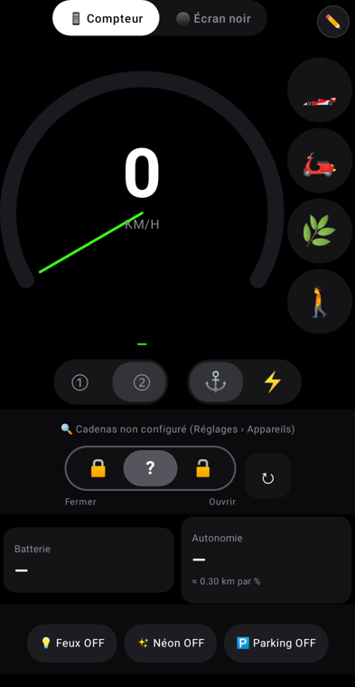
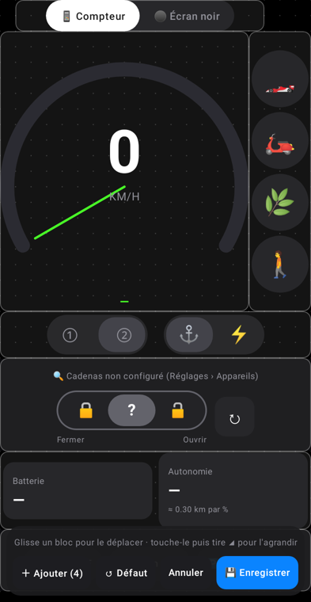
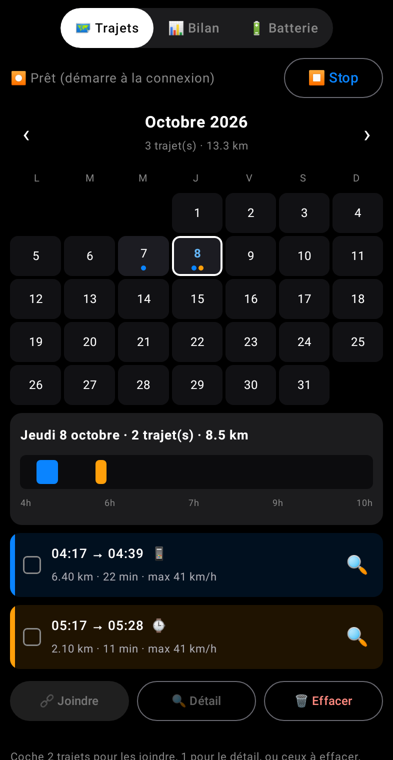

### Ta trottinette iX7 Pro, enfin connectée : sur le téléphone, et au poignet.

---

**Ride Companion** remplace l'appli officielle de la trottinette **iX7 Pro** par une appli plus complète et plus fiable. Tableau de bord en direct, trajets enregistrés tout seuls avec la carte, suivi de la batterie dans la durée… et une vraie appli **Wear OS** pour tout piloter sans sortir le téléphone.

 Tableau de bord · Personnalisation glisser-déposer · Calendrier des trajets

---

## ✨ Ce que fait l'appli

### 📱 Sur le téléphone

- 🏁 **Tableau de bord en direct, à ta façon** : vitesse, batterie, autonomie, tension, puissance, températures. Tu places les tuiles où tu veux.
- 🎚️ **Pilotage complet** : modes Piéton, Eco, Race et Sport, 1 ou 2 roues, phare, néon, régulateur, vitesse max par mode.
- 🅿️ **Parking automatique** : la trottinette se verrouille et coupe ses feux dès que tu te déconnectes.
- 🔐 **Cadenas connecté** : ouvre et ferme ton cadenas Bluetooth depuis l'appli.
- 🗺️ **Trajets automatiques** : départ et arrivée détectés tout seuls, carte colorée selon la vitesse, historique complet.
- 📊 **Bilan** : km, temps, vitesse moyenne et de pointe, énergie et coût de recharge, par semaine, mois et année.
- 🔋 **Santé de la batterie** : recharges, autonomie réelle, alertes de batterie basse qui ne se déclenchent pas pour rien.
- 💾 **Tes données t'appartiennent** : sauvegarde en clair dans le dossier de ton choix (pCloud, Drive…). Tu récupères tout en un clic sur un nouveau téléphone.

### ⌚ Sur la montre

- Vitesse, batterie et mode d'un coup d'œil
- Parking, phare, néon et vitesses en un geste
- Cadenas depuis le poignet
- Trajets enregistrés même sans le téléphone, puis synchronisés
- Écran gardé allumé pendant toute la balade

---

## 💎 Gratuit ou Premium

| | Gratuit | Premium |
|---|:---:|:---:|
| Tableau de bord en direct | ✅ | ✅ |
| Modes, feux, parking | ✅ | ✅ |
| Trajets récents avec carte | ✅ | ✅ |
| ⌚ **Appli Wear OS** | | ✅ |
| Historique illimité et export | | ✅ |
| Bilan annuel et santé de la batterie | | ✅ |
| Cadenas connecté | | ✅ |

*Premium = un seul achat, sans abonnement. Le détail peut encore évoluer d'ici la sortie.*

---

## 🛴 Compatibilité

| | |
|---|---|
| Trottinette **iX7 Pro** | ✅ Testée tous les jours |
| Cadenas Bluetooth **Solebe** | ✅ |
| Téléphone **Android 8.0+** | ✅ |
| Montre **Wear OS 3+** | ✅ (testée sur Xiaomi Watch 2) |

---

## 🗓️ Où en est le projet

- [x] Appli téléphone et montre utilisées au quotidien
- [x] Nouvelle identité : **Ride Companion**
- [x] Captures d'écran
- [ ] Vidéo de démo
- [ ] Version anglaise 🇬🇧
- [ ] Test public
- [ ] Sortie sur **Google Play**

Pour être prévenu de la sortie, clique sur **Watch › Custom › Releases** en haut de cette page.

---

## 💬 Contact

Une question, un modèle de trottinette à ajouter, envie de tester en avant-première ? Ouvre une [*issue*](../../issues).

---

Ce dépôt est une vitrine : le code source de l'appli est privé. © 2025-2026 soaresden, tous droits réservés.
Projet indépendant, non affilié aux fabricants cités. Les marques citées appartiennent à leurs propriétaires.
